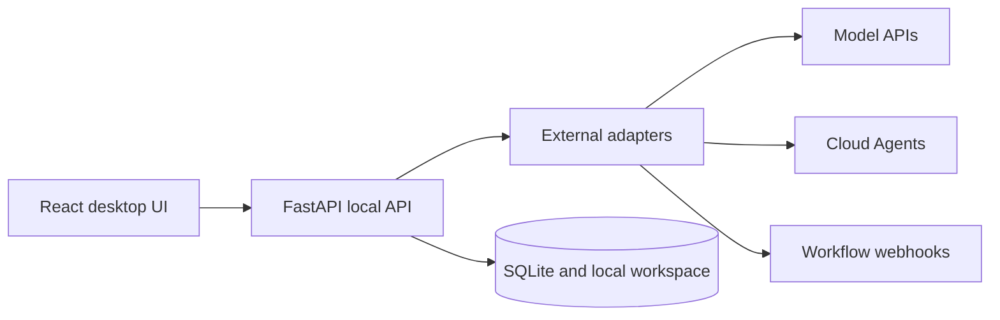

# QZHOU（轻舟）

QZHOU（轻舟） is a local-first AI workspace for everyday users. It connects models and cloud agents, keeps conversations and projects together, and brings generated files back to the desktop.

**Status: 0.1.0 Alpha, Windows source release.** This package requires a development environment and does not include a signed installer. The upstream services were not re-run while preparing this release, so availability depends on your provider, model, credentials, and permissions.

## Scope

- Manage model connections, external agents, and project conversations in one window.
- Call OpenAI-compatible model APIs and external workflows through webhooks.
- Connect to Volcano Ark Managed Agents Session event streams and receive provider-generated files.
- Upload a CSV and create a Session; create the Agent and Environment in the provider console.
- Save conversations and received artifacts locally, with options to view and export them.

QZHOU（轻舟） calls external capabilities, receives the result, and saves it locally. Planning, execution, and tools belong to the upstream Agent service. Actual capabilities depend on the configured provider and permissions.

## Windows setup

Install Node.js 22 and Python 3.12, then make sure `node`, `npm`, and `python` are available in PowerShell. From the project root:

```powershell
python -m venv .venv
.\.venv\Scripts\python.exe -m pip install -r server\requirements.txt
npm ci
npm --prefix app ci
npm run build:app
npm start
```

Dependency installation requires network access. Electron starts the local Python service on port 8000. On first launch, add your own connections in **Models & Connections** or **Agent Library**. No personal connections, keys, conversations, or artifacts are included.

Run `npm start` again from the project root. To use another Python executable, set `LIGHTBOAT_PYTHON` to its full path.

## Data, privacy, and cost

- Runtime data is stored under `data/`, including the local database, Agent configuration, uploads, and workspace files.
- **API keys are currently stored in plaintext on the local machine.** Never share a populated `data/` directory or commit it to GitHub.
- “Local-first” describes where data is stored. Remote models and Agents receive the content, history, and attachments you send them.
- Sending a task, uploading a CSV, or creating a Session makes a real upstream request and may incur charges. This release does not include a default per-call budget gate; provider quotas and billing apply.
- Closing the window may not cancel a task already running upstream. Cancellation and billing are controlled by the provider.
- Check provider access and policies before using **Probe channel**. It opens the event stream for connectivity checks but does not submit an inference message.

See [Privacy and Security](docs/PRIVACY.md).

## Repository layout

```text
app/src/                   React UI and frontend entry points
electron/                  Desktop window, startup, and local file access
server/app/api.py          Local API entry point
server/app/adapters.py     External service adapters
server/app/                Local data, project, and support code
```

## Contributing

Read [CONTRIBUTING.md](CONTRIBUTING.md) and [ARCHITECTURE.md](ARCHITECTURE.md) before changing the project. Please include reproduction steps and sanitized errors in issues. Remove keys, tokens, personal data, and private provider URLs from reports. Windows development is the current focus; signed installers, cross-platform distribution, and an independent security audit are not provided yet.

## Product overview

QZHOU is built around a simple loop:

```text
Choose a provider or Agent
          |
          v
Send a real task and watch its status
          |
          v
Receive the response and generated artifacts
          |
          v
Keep the result in a local project workspace
```

### What is included

| Area | Capability |
| --- | --- |
| Model connections | OpenAI-compatible APIs, local model endpoints, and provider-specific settings |
| External Agents | Session event streams, channel probing, CSV upload, and Session creation |
| Workflows | Webhook calls to external workflow services |
| Projects | Conversations, history, project files, and generated artifacts |
| Desktop | Electron window, local FastAPI service, SQLite storage, and local export |

### Architecture



The upstream provider owns Agent planning, tools, workflow execution, and model hosting. QZHOU presents the task, status, response, and artifacts in one local workspace.

### Current limitations

This is an early Windows source release. API keys are stored locally in plaintext, the project does not ship a signed installer, and provider integrations still need to be checked with real credentials. See [Privacy and Security](docs/PRIVACY.md) before connecting an account.

## License

The project code is released under [AGPL-3.0-only](LICENSE). Distributed modified versions and modified network services must provide corresponding source under AGPL-3.0-only. The QZHOU name and logos are not licensed as trademarks. Third-party dependencies retain their own licenses; see [THIRD_PARTY_NOTICES.md](THIRD_PARTY_NOTICES.md).
